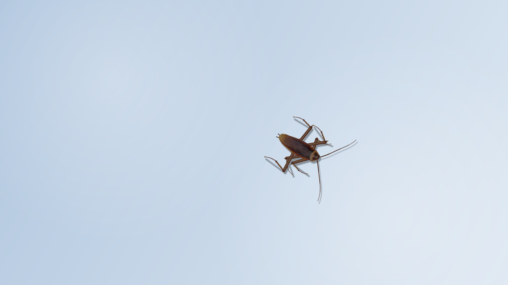
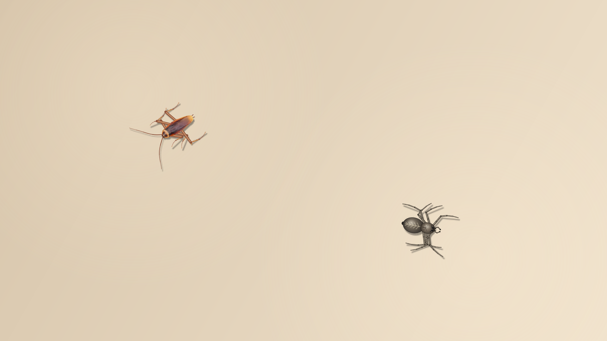

# Bichos en pantalla

De vez en cuando, al azar, una **cucaracha o una araña** cruza tu escritorio por todos tus monitores. Camina con patas animadas, proyecta sombra, corre, frena y se asusta si acercás el mouse. Una broma inofensiva para Windows.



*(Imágenes generadas con el propio motor del programa sobre un fondo liso.)*

## Descargar y probar

**Opción recomendada: [Microsoft Store](https://apps.microsoft.com/detail/9NRTV80JVZ6B)** (gratis). Firmada por Microsoft, se instala con un clic, se actualiza sola y no muestra el aviso de SmartScreen.

**Opción portable (`.exe` suelto):**

1. Entrá a **[Releases](https://github.com/lucianociotti/bichos-en-pantalla/releases/latest)** y bajá `BichosPantalla.exe`.
2. Doble clic. No hay que instalar nada (Windows 10/11 de 64 bits). Tarda 2–4 segundos en arrancar.
3. Aparece el icono de la cucaracha en la bandeja, junto al reloj. El primer bicho sale a los 6–12 segundos.

**Menú del icono** (botón derecho): soltar un bicho ahora, frecuencia, qué insecto, tamaño, "se asusta del mouse", ver el registro y **Salir**.

> **Aviso de Windows:** el `.exe` no tiene firma digital (el certificado es de pago), así que SmartScreen puede mostrar "Windows protegió su PC". Tocá *Más información → Ejecutar de todas formas*. Podés verificar que es el original comparando su SHA256 con el que figura en la página del release (`Get-FileHash BichosPantalla.exe` en PowerShell).

**Desinstalar:** *Salir* desde el icono, borrar el `.exe` y la carpeta `%LOCALAPPDATA%\BichosPantalla`. No toca el registro ni deja nada más.

Usalo en computadoras ajenas **solo con permiso de su dueño**.

## Qué hace y qué no hace
- Dibuja ventanas transparentes con el bicho (se puede hacer clic a través de él) y las mueve. Lee la posición del mouse solo para que el bicho se asuste; no la guarda.
- **No usa internet** (0 conexiones medidas), no lanza otros programas por su cuenta (solo abre el archivo de registro en tu editor de texto si elegís *Ver registro*), no captura pantalla ni teclado, no toca el registro y no pide permisos de administrador.
- Guarda solo sus ajustes y un registro técnico en `%LOCALAPPDATA%\BichosPantalla`. Nada sale de tu PC.
- Detalle de la revisión de seguridad: [docs/GUIA.md](docs/GUIA.md#seguridad-revisión-del-2026-11-15).



## Para desarrolladores
Es Python + [PyQt6](https://www.riverbankcomputing.com/software/pyqt/).

```bash
pip install PyQt6                # el programa
pip install pyinstaller          # para compilar el .exe
python bichos.py                 # corre en segundo plano (icono en la bandeja)
python bichos.py --ya            # suelta un bicho enseguida
```

- Compilar el `.exe`: `herramientas\crear_exe.bat` (usa `herramientas\BichosPantalla.spec`, que deja afuera todo lo que el programa no usa).
- Paquete MSIX para la Microsoft Store: `herramientas\crear_msix.bat` ([guía](herramientas/msix/LEEME_STORE.md)).
- Herramientas de desarrollo (no van en el .exe): `python bichos.py --png salida.png` (hoja de prueba sin ventanas), `--test`, `--probar-pantallas`, `--debug`.
- Cómo agregar fotos de otros bichos, registros, seguridad: [docs/GUIA.md](docs/GUIA.md). Cómo sacar una versión nueva: [docs/PUBLICAR.md](docs/PUBLICAR.md).

## Ideas para próximas versiones
Sonidos, aplastarlo con clic o atajo, que se esconda bajo las ventanas, más especies, arañas con foto. Ver [CHANGELOG.md](CHANGELOG.md). Las ideas y pull requests son bienvenidos (abrí un *issue*).

## Créditos y licencias
- Código: [MIT](LICENSE) © Luciano Ciotti.
- Fotografía de la cucaracha: **CC0**, Alex Wild / Insects Unlocked (Univ. de Texas en Austin), vía Wikimedia Commons.
- Los `.exe` incluyen PyQt6 (GPL v3) y Qt (LGPL v3): ver [THIRD_PARTY_NOTICES.md](THIRD_PARTY_NOTICES.md).
